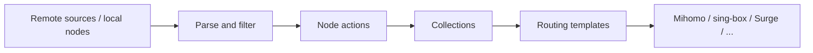

<div align="center">
  
  <h1>Sub-Store Cloudflare</h1>
  <p>Aggregate subscriptions, process proxy nodes, and generate client configs on Cloudflare Workers.</p>

  [](https://github.com/Jayden-27/sub-store-cloudflare/releases)
  [](LICENSE)
  [](https://developers.cloudflare.com/workers/)
  [](https://developers.cloudflare.com/d1/)
  [](https://www.typescriptlang.org/)

  [](https://deploy.workers.cloudflare.com/?url=https://github.com/Jayden-27/sub-store-cloudflare)

  [中文](README.md) · [English](README.en.md)
</div>

## Overview

Sub-Store Cloudflare is an independently maintained subscription management service designed for the Cloudflare Free plan. It combines remote sources and local nodes in one processing pipeline, then produces client-specific download links.

The architecture stays intentionally small:

- Workers Static Assets serve the admin UI
- The Worker API handles business requests
- D1 stores sources, collections, templates, and settings
- Worker Secrets hold the admin and download tokens
- No KV, R2, Durable Objects, Queues, or Cron

## Features

- Remote sources, local nodes, and collections
- Region, protocol, regex, dedupe, sorting, and resolver actions
- Build-time JavaScript Filter / Operator without runtime scripts from D1 or remote URLs
- Mihomo, Stash, Surge, Surge Mac, Surfboard, Loon, Egern, Shadowrocket, Quantumult X, sing-box, V2Ray, URI, and JSON output
- Mihomo / Stash / sing-box routing templates with generated-node merging
- One-shot proxy, subscription, and rule conversion tools
- Revocable, expiring, target-scoped download links
- Backup, restore, and a bounded 50-entry recycle bin
- Subscription metadata propagation, edge caching, and stale-cache fallback

## Data flow



## Quick deploy

### 1. Generate two different tokens

```bash
node --input-type=module -e "import{randomBytes}from'node:crypto';console.log(randomBytes(32).toString('base64url'));console.log(randomBytes(32).toString('base64url'))"
```

Use them for `SUB_STORE_ADMIN_TOKEN` and `SUB_STORE_PUBLIC_DOWNLOAD_TOKEN`. Never reuse one value for both.

### 2. Deploy to Cloudflare

Click **Deploy to Cloudflare** above. Cloudflare imports a repository copy, creates the Worker, configures D1, and asks for both secrets.

### 3. Open the admin UI

```text
https://<your-worker-domain>/?token=<SUB_STORE_ADMIN_TOKEN>
```

See the [five-minute quick start](docs/quick-start.md) for the complete walkthrough.

## Install paths

| Need | Method | Entry point |
| --- | --- | --- |
| Fastest web-configured deployment | Deploy to Cloudflare | Button above |
| Guided terminal deployment | Interactive CLI | `pnpm run install:cloudflare` |
| Empty deployment | CLI quick mode | `pnpm run install:quick` |
| Import sources through a local AI agent | Agent install | [Install prompt](agent/install.prompt.md) |
| Full control of D1, secrets, and domains | Manual Wrangler | [Deployment guide](docs/deployment.md) |

### Local CLI deployment

```bash
git clone https://github.com/Jayden-27/sub-store-cloudflare.git
cd sub-store-cloudflare
corepack enable
pnpm run install:cloudflare
```

Empty deployment:

```bash
pnpm run install:quick
```

## Templates and output

- `mihomo` / `stash`: YAML with top-level runtime, DNS, sniffer, and TUN settings preserved.
- `sing-box`: JSON merged deeply with generated outbounds by `tag`.
- Templates apply only to their matching output target.
- Proxy groups support `include-all` and `$all`; `$all` expands nodes in source order at generation time.
- Each collection binds one template; create multiple collections for multiple client profiles.

## Security

- Admin UI and `/api/*` use the admin token; `/download/*` uses a separate download token.
- Download grants can expire, be disabled, or be restricted to one output target.
- Build-time scripts come from repository manifests, not from D1, the browser, or remote JavaScript.
- Keep the Mihomo `external-controller` bound to `127.0.0.1` unless it is protected by a secret and firewall.
- Never commit subscription URLs, node URIs, tokens, private D1 IDs, or generated seed SQL.

See [SECURITY.md](SECURITY.md) for details.

## Project layout

```text
.
├── cloudflare/       Worker API, D1 access, renderers, tests
├── frontend/         Vue 3 admin UI
├── config/           Templates, presets, build-time scripts
├── scripts/          Installer, validation, generation, release tools
├── docs/             Deployment, architecture, compatibility, troubleshooting
├── agent/            AI agent install entry point
└── wrangler.jsonc    Workers and Static Assets configuration
```

## Documentation

- [Quick start](docs/quick-start.md)
- [Deployment](docs/deployment.md)
- [Upgrading](docs/upgrading.md)
- [Architecture](docs/architecture.md)
- [JavaScript Filter / Operator](docs/script-plugins.md)
- [Compatibility matrix](docs/upstream-compatibility.md)
- [Product scope](docs/product-scope.md)
- [Troubleshooting](docs/troubleshooting.md)
- [Testing and release checks](docs/testing.md)
- [All documentation](docs/README.md)

## Local development

```bash
corepack enable
pnpm run setup
cp cloudflare/.dev.vars.example cloudflare/.dev.vars
pnpm run build:frontend
pnpm run dev
```

Open `http://localhost:8787/?token=dev-admin-token`.

Common checks:

```bash
pnpm run check
pnpm run check:tests
pnpm run deploy:local:dry-run
```

## Credits and license

The product concept and frontend experience are inspired by
[Sub-Store](https://github.com/sub-store-org/Sub-Store) and
[Sub-Store-Front-End](https://github.com/sub-store-org/Sub-Store-Front-End).
The Cloudflare-native foundation originally came from
[realchendahuang/sub-store-cloudflare](https://github.com/realchendahuang/sub-store-cloudflare);
this repository is now maintained independently and is no longer in that repository's fork network.

Licensed under [AGPL-3.0-or-later](LICENSE). See [NOTICE](NOTICE) for third-party attribution.
