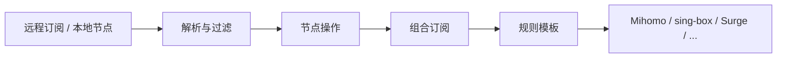

<div align="center">
  
  <h1>Sub-Store Cloudflare</h1>
  <p>在 Cloudflare Workers 上聚合订阅、处理节点并生成客户端配置。</p>

  [](https://github.com/Jayden-27/sub-store-cloudflare/tags)
  [](LICENSE)
  [](https://developers.cloudflare.com/workers/)
  [](https://developers.cloudflare.com/d1/)
  [](https://www.typescriptlang.org/)

  [](https://deploy.workers.cloudflare.com/?url=https://github.com/Jayden-27/sub-store-cloudflare)

  [中文](README.md) · [English](README.en.md)
</div>

## 项目定位

Sub-Store Cloudflare 是一个独立维护、面向 Cloudflare 免费版的订阅管理服务。它把远程订阅和本地节点统一到一套处理链路中，在 Worker 内完成过滤、重命名、去重、排序和规则模板渲染，最后为不同客户端提供独立下载链接。

架构保持精简：

- Workers Static Assets 提供管理界面
- Worker API 处理业务请求
- D1 保存订阅源、组合、模板和设置
- Worker Secrets 保存管理端与下载端 Token
- 不依赖 KV、R2、Durable Objects、Queues 或 Cron

## 主要能力

- 远程订阅、本地节点和组合订阅
- 区域、协议、正则、去重、排序、域名解析等节点处理
- 预览时显示每个节点操作前后的节点数，便于定位规则影响
- 构建时 JavaScript Filter / Operator，不执行来自 D1 或网络的运行时脚本
- Mihomo、Stash、Surge、Surge Mac、Surfboard、Loon、Egern、Shadowrocket、Quantumult X、sing-box、V2Ray、URI 和 JSON 输出
- Mihomo / Stash / sing-box 规则模板，支持模板字段透传与动态节点合并
- 一次性节点、订阅和规则转换工具
- 从原版 Sub-Store 备份导入订阅源和组合订阅
- 订阅列表批量启用、停用、加标签和删除
- 智能导入 URI、Base64、Mihomo YAML 和 JSON 节点，按地区预览后合并到现有订阅源
- 可撤销、可过期、可限制输出格式的独立分享链接
- 订阅链接自检：服务端生成一次并返回节点数、体积、耗时和内容预览
- 配置备份、恢复和最多 50 条的回收站
- 订阅流量元数据透传、边缘缓存和失败回退

## 数据流



## 快速部署

### 1. 生成两个不同的 Token

```bash
node --input-type=module -e "import{randomBytes}from'node:crypto';console.log(randomBytes(32).toString('base64url'));console.log(randomBytes(32).toString('base64url'))"
```

分别用于 `SUB_STORE_ADMIN_TOKEN` 和 `SUB_STORE_PUBLIC_DOWNLOAD_TOKEN`，不要复用同一个值。

### 2. 部署到 Cloudflare

点击顶部 **Deploy to Cloudflare**。Cloudflare 会导入仓库副本、创建 Worker、配置 D1，并要求填写两个 Secret。

### 3. 打开管理页面

```text
https://<你的 Worker 域名>/?token=<SUB_STORE_ADMIN_TOKEN>
```

首次进入后添加订阅源，检查组合订阅，然后复制客户端下载链接。

完整步骤见 [五分钟快速开始](docs/quick-start.md)。

## 安装方式

| 场景 | 方式 | 入口 |
| --- | --- | --- |
| 最快部署，之后在网页配置 | Deploy to Cloudflare | README 顶部按钮 |
| 通过终端完成部署与导入 | 交互式 CLI | `pnpm run install:cloudflare` |
| 部署空应用 | CLI 快速模式 | `pnpm run install:quick` |
| 让本地 AI Agent 导入订阅并返回链接 | Agent 安装 | [安装提示词](agent/install.prompt.md) |
| 完全控制 D1、Secret 和域名 | 手动 Wrangler | [部署说明](docs/deployment.md) |

### 本地 CLI 部署

```bash
git clone https://github.com/Jayden-27/sub-store-cloudflare.git
cd sub-store-cloudflare
corepack enable
pnpm run install:cloudflare
```

只部署空应用：

```bash
pnpm run install:quick
```

## 模板与输出

- `mihomo` / `stash`：YAML，保留模板中的运行、DNS、sniffer、TUN 等顶层配置。
- `sing-box`：JSON，与运行时出站配置按 `tag` 深度合并。
- 模板只作用于匹配的输出目标，不同客户端之间不会互相套用。
- 代理组支持 `include-all` 与 `$all`；使用 `$all` 可在生成时按源顺序展开节点。
- 一个组合订阅绑定一个模板；需要多套客户端配置时创建多个组合。
- 内置模板在首次部署时写入 D1，之后可自由编辑、删除或恢复默认；升级只会补种新增模板，不覆盖你的修改。
- 模板可配置更新地址，从远程 YAML 同步最新规则。内置模板默认指向本仓库 `config/templates/`，打开设置页时超过 6 小时会自动检查一次；有本地修改的模板默认跳过。
- 「源文件」以只读方式展示远程原文，保留注释；编辑区仍显示规范化后的配置。

## 安全设计

- 管理端和 `/api/*` 使用 admin token，`/download/*` 使用独立的 download token。
- 下载链接支持过期、停用和输出格式限制。
- 构建时脚本来自仓库清单，不从 D1、浏览器或远程 URL 动态加载 JavaScript。
- 建议将 Mihomo `external-controller` 限制在 `127.0.0.1`，不要在无认证时暴露到局域网。
- 不要提交订阅 URL、节点 URI、Token、私有 D1 ID 或生成的 seed SQL。

更多内容见 [SECURITY.md](SECURITY.md)。

## 项目结构

```text
.
├── cloudflare/        Worker API、D1 访问层、渲染与测试
├── frontend/          Vue 3 管理界面
├── config/            模板、预设和构建时脚本
├── scripts/           安装、校验、生成与发布工具
├── docs/              部署、架构、兼容性和排障文档
├── agent/             AI Agent 安装入口
└── wrangler.jsonc     Workers 与 Static Assets 配置
```

## 文档

- [五分钟快速开始](docs/quick-start.md)
- [部署说明](docs/deployment.md)
- [升级指南](docs/upgrading.md)
- [架构说明](docs/architecture.md)
- [JavaScript Filter / Operator](docs/script-plugins.md)
- [兼容矩阵](docs/upstream-compatibility.md)
- [产品边界](docs/product-scope.md)
- [故障排查](docs/troubleshooting.md)
- [测试与发布检查](docs/testing.md)
- [全部文档](docs/README.md)

## 本地开发

```bash
corepack enable
pnpm run setup
cp cloudflare/.dev.vars.example cloudflare/.dev.vars
pnpm run build:frontend
pnpm --dir cloudflare run dev:migrate
pnpm run dev
```

打开 `http://localhost:8787/?token=dev-admin-token`。

常用检查：

```bash
pnpm run check
pnpm run check:tests
pnpm run deploy:local:dry-run
```

## 致谢与许可

产品思路和前端体验受 [Sub-Store](https://github.com/sub-store-org/Sub-Store) 与
[Sub-Store-Front-End](https://github.com/sub-store-org/Sub-Store-Front-End) 启发。
Cloudflare-native 基础最初来自
[realchendahuang/sub-store-cloudflare](https://github.com/realchendahuang/sub-store-cloudflare)；
当前仓库独立维护，不再处于原仓库的 fork 网络中。

本项目使用 [AGPL-3.0-or-later](LICENSE) 许可，第三方来源说明见 [NOTICE](NOTICE)。
